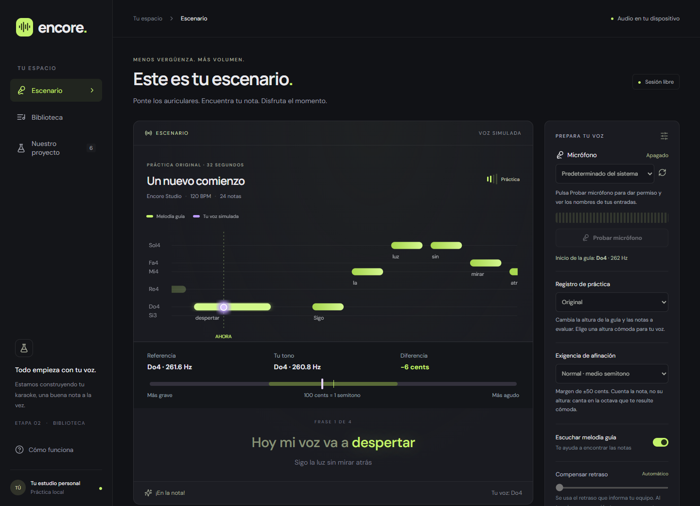
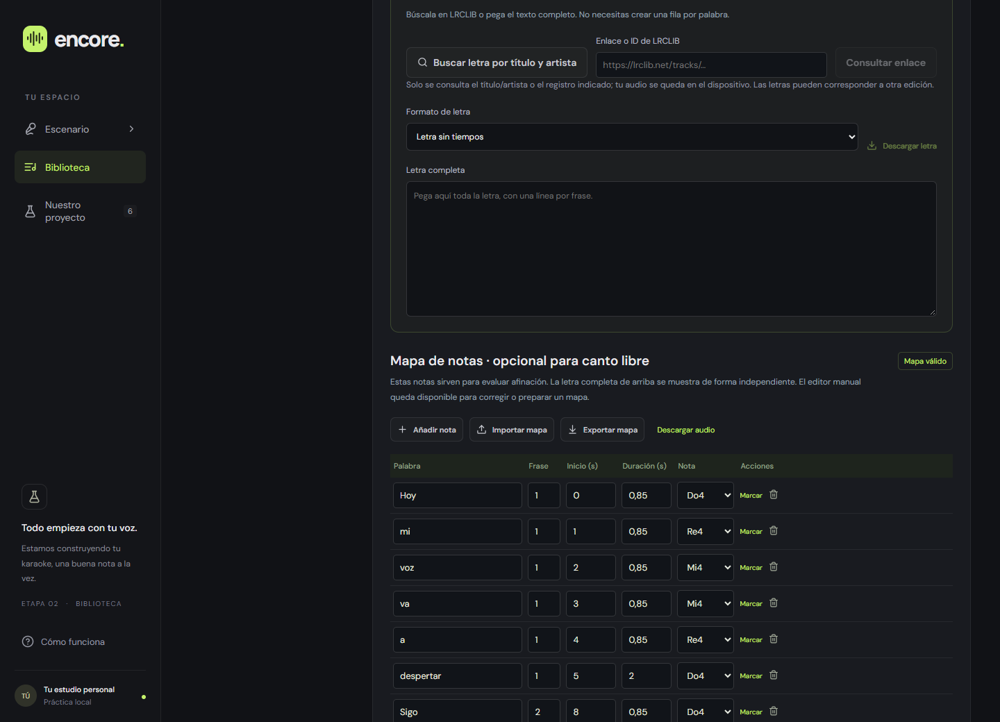

# Encore · Karaoke personal

Karaoke para practicar con tu propia música. Encore escucha tu voz por el micrófono, detecta la nota que cantas en tiempo real y la compara con la melodía de la canción. Todo ocurre en tu computadora: tu voz no se graba ni se envía a ningún servidor.



> **Estado:** en desarrollo (revisión 2F). El recorrido completo funciona y está cubierto por pruebas automáticas con voz sintética. Todavía falta validarlo con voces reales y distintos micrófonos; consulta [Limitaciones](#limitaciones-conocidas).

## Características

- **Escenario de canto** con barras de notas, letra sincronizada, afinador en vivo (en cents) y puntuación sobre 10.000.
- **Tres niveles de exigencia.** En Relajada y Normal cuenta la nota y no su altura: puedes cantar en la octava que te resulte cómoda.
- **Biblioteca propia.** Importa MP3, WAV, OGG, M4A, FLAC o WebM (hasta 30 MB y 10 minutos) y guárdalos en el navegador.
- **Editor de letra y notas.** Marca tiempos mientras escuchas, desplaza el mapa completo e importa o exporta mapas en JSON.
- **Letras con tiempos** desde [LRCLIB](https://lrclib.net) y metadatos de la grabación desde [MusicBrainz](https://musicbrainz.org).
- **Preparación automática opcional.** Separa la voz del acompañamiento y propone un mapa de notas a partir de la voz aislada, sin salir de tu equipo.
- **Tres acompañamientos** tras separar: voz original, voz al 25 % o solo instrumental.
- **Ajustes que se adaptan a tu equipo.** Compensa el retraso de audio, ajusta la sensibilidad al nivel de tu micrófono y avisa si la música está entrando por él.
- **Resultados explicados** por frase, con descarga en JSON.



## Requisitos

| Para | Necesitas |
| --- | --- |
| Usar la aplicación | [Node.js](https://nodejs.org) 22.18 o superior y un navegador basado en Chromium (Edge, Chrome u Opera) |
| Cantar con puntuación fiable | Auriculares, para que la música no entre por el micrófono |
| Preparación automática (opcional) | [uv](https://docs.astral.sh/uv/), unos 1,3 GB de disco y varios minutos de CPU por canción |
| Pruebas de navegador (opcional) | Microsoft Edge |

Desarrollado y probado en Windows 11. No se ha verificado en macOS ni Linux.

## Inicio rápido

```bash
git clone https://github.com/Byron45/encore-karaoke.git
cd encore-karaoke
npm install
npm run dev
```

Abre <http://127.0.0.1:5173>. El micrófono solo funciona en `localhost`, `127.0.0.1` o HTTPS.

## Cómo se usa

### 1. Prueba el escenario

Pulsa **Ver demo** para ver el recorrido con una voz simulada. Después conecta los auriculares, elige tu entrada, pulsa **Probar micrófono** y luego **Empezar a cantar**. El ejercicio incluido dura 32 segundos.

### 2. Canta tu música

1. En **Biblioteca**, pulsa **Cargar audio** y elige un archivo que tengas permiso de usar.
2. Añade la letra: búscala en LRCLIB por título y artista, o pégala completa.
3. Prepara las notas, a mano en el editor o con **Separar voz y generar mapa**.
4. Pulsa **Guardar y cantar**.

Con letra y sin notas también puedes cantar: la app reproduce tu audio y avanza la letra, sin puntuación.

### 3. Ajusta la evaluación

En el panel **Prepara tu voz**:

- **Exigencia de afinación** decide cuánto margen tienes (tabla siguiente).
- **Compensar retraso** empieza en automático. Al terminar una canción, si tu voz encaja mejor con otro valor, aparece un botón para usarlo; se recuerda para ese micrófono.

## Cómo se puntúa

La puntuación mide cuánto tiempo sostienes la nota correcta. No reconoce palabras ni valora la interpretación.

| Exigencia | Crédito completo | Sin crédito desde | Octava | Referencia |
| --- | --- | --- | --- | --- |
| Relajada | ±100 cents (un semitono) | 200 cents | cualquiera | la nota escrita o la curva original, la más cercana |
| Normal (por defecto) | ±50 cents | 150 cents | cualquiera | la nota escrita o la curva original, la más cercana |
| Estricta | ±35 cents | 100 cents | exacta | la curva original |

Los silencios previstos no suman ni restan; no cantar durante una nota sí reduce el resultado. Los resultados solo son comparables entre intentos con la misma exigencia.

## Preparación automática

Es opcional y se instala aparte, porque descarga dependencias pesadas de Python:

```bash
npm run audio:setup
```

Crea un entorno aislado en `.venv-audio` con Python 3.11 y dependencias fijadas. El primer uso descarga el modelo de separación (unos 67 MB). Todo el procesamiento se hace por CPU en tu equipo.

El mapa generado es **experimental**: puede cubrir solo parte de la canción, equivocarse de octava o confundir coros con la voz principal. Escucha la voz aislada y revisa las notas antes de fiarte de la puntuación.

## Privacidad

- La voz se analiza en el navegador con un AudioWorklet. No se graba ni se sube.
- La biblioteca vive en IndexedDB, en tu navegador. No hay cuentas ni copia en la nube: borrar los datos del sitio borra la biblioteca.
- El servidor local escucha solo en `127.0.0.1`. La preparación de audio comprueba además el origen de cada petición y un token de sesión.
- Conexiones externas, todas iniciadas por una acción tuya salvo la primera:
  - Google Fonts, al cargar la página (hay tipografías locales de respaldo).
  - MusicBrainz y LRCLIB, al pulsar buscar; se envían solo título y artista.
  - La descarga del modelo, la primera vez que separas una canción.

## Pruebas

```bash
npm test             # 53 pruebas unitarias: detector, puntuación, mapas, letras, servicios
npm run build        # comprobación de tipos y compilación
npm run test:browser # 39 pruebas de extremo a extremo; requiere `npm run dev` activo y Microsoft Edge
```

Las pruebas de navegador hacen pasar una voz sintética por el micrófono, el detector y la puntuación reales. No sustituyen una prueba con voz humana.

## Estructura del proyecto

```
src/            Interfaz en React y motor de canto
  audio.ts        Reloj de la canción, captura y calibración
  scoring.ts      Puntuación y diagnóstico
  capture.ts      Ruido de fondo, nivel y detección de altavoces
  Stage.tsx       Escenario, afinador y letra
  Library.tsx     Biblioteca y editor
public/audio/   Detector de tono (YIN) que corre en el AudioWorklet
server/         Servicios locales como complementos de Vite: MusicBrainz, LRCLIB y preparación
scripts/audio/  Motor de Python: separación de voz y análisis de melodía
tests/          Pruebas unitarias; tests/browser contiene las de extremo a extremo
docs/           Notas técnicas, plan por etapas y evaluaciones
```

## Limitaciones conocidas

- **Hacen falta auriculares.** Sin ellos la música se mezcla con tu voz y la puntuación deja de ser fiable. La app lo detecta y avisa, pero no lo corrige.
- **Sin validar con voz real.** La evaluación está comprobada con señal sintética; faltan pruebas con personas, micrófonos distintos y auriculares Bluetooth.
- **El retraso automático es una estimación.** Parte de lo que informa el equipo, que puede no coincidir con el real; por eso existe la propuesta al terminar cada canción.
- **El mapa automático es experimental** y suele quedar fragmentado en notas muy cortas.
- **El audio importado no se transpone.** Se reproduce en su tono original.
- **Los servicios locales dependen de Vite** (`npm run dev` o `npm run preview`). Copiar solo `dist/` a un alojamiento estático no incluye las búsquedas ni la preparación.
- **No hay historial de puntuaciones**, pausa ni cola de canciones.

## Próximos pasos propuestos

- [ ] Validar con voz real, auriculares y varios micrófonos.
- [ ] Mejorar el mapa automático: unir notas fragmentadas y obtener tiempos por sílaba.
- [ ] Importar mapas hechos a mano.
- [ ] Récords locales, pausa y cola de canciones.
- [ ] Copia de seguridad de la biblioteca y guardado que no reescriba el audio en cada cambio.
- [ ] Formateador, linter e integración continua.

El plan original por etapas está en [docs/ETAPAS.md](docs/ETAPAS.md).

## Documentación

- [Notas técnicas por etapa](docs/NOTAS-TECNICAS.md): decisiones, límites y detalle de cada entrega.
- [Preparación automática](docs/PREPARACION-AUTOMATICA.md): diseño de la separación y del mapa.
- [Punto de continuación](docs/CONTINUAR.md): estado actual y siguiente paso.
- Evaluaciones de cada etapa en `docs/EVALUACION-*.md`.

## Tecnología y créditos

React 19, TypeScript y Vite. Web Audio API para la captura y el análisis. Playwright para las pruebas de navegador.

El motor opcional usa [python-audio-separator](https://github.com/nomadkaraoke/python-audio-separator) con un modelo UVR-MDX-NET, [torchcrepe](https://github.com/maxrmorrison/torchcrepe) y [librosa](https://librosa.org). Los iconos son de [Lucide](https://lucide.dev). Los metadatos proceden de MusicBrainz y las letras de LRCLIB; cada servicio tiene sus propias condiciones de uso.

Encore no incluye ni descarga canciones. Usa solo audio y letras que tengas derecho a utilizar.

## Licencia

Proyecto personal en desarrollo, todavía sin licencia de código abierto.
